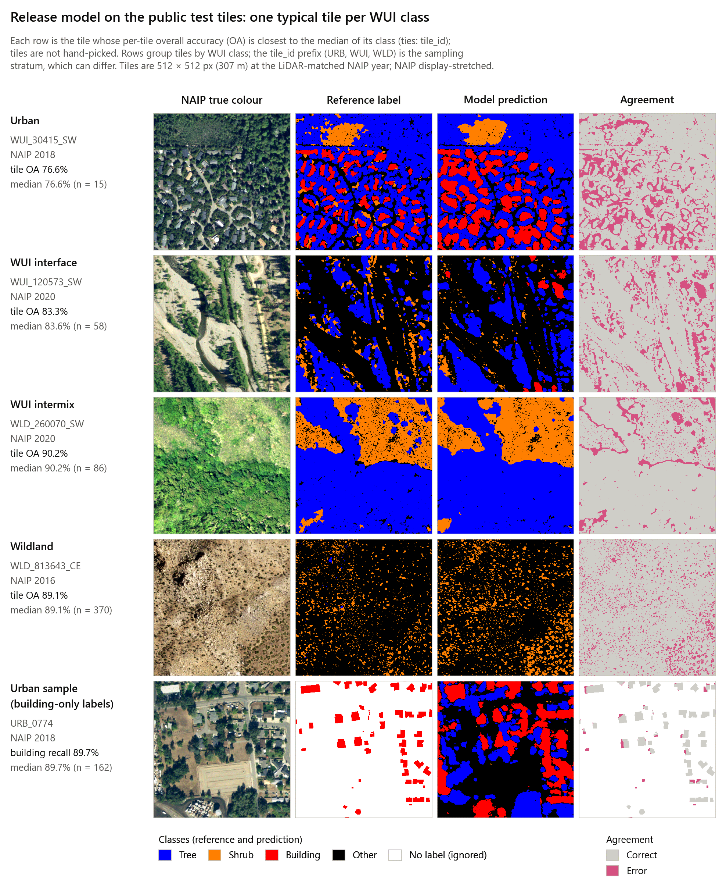
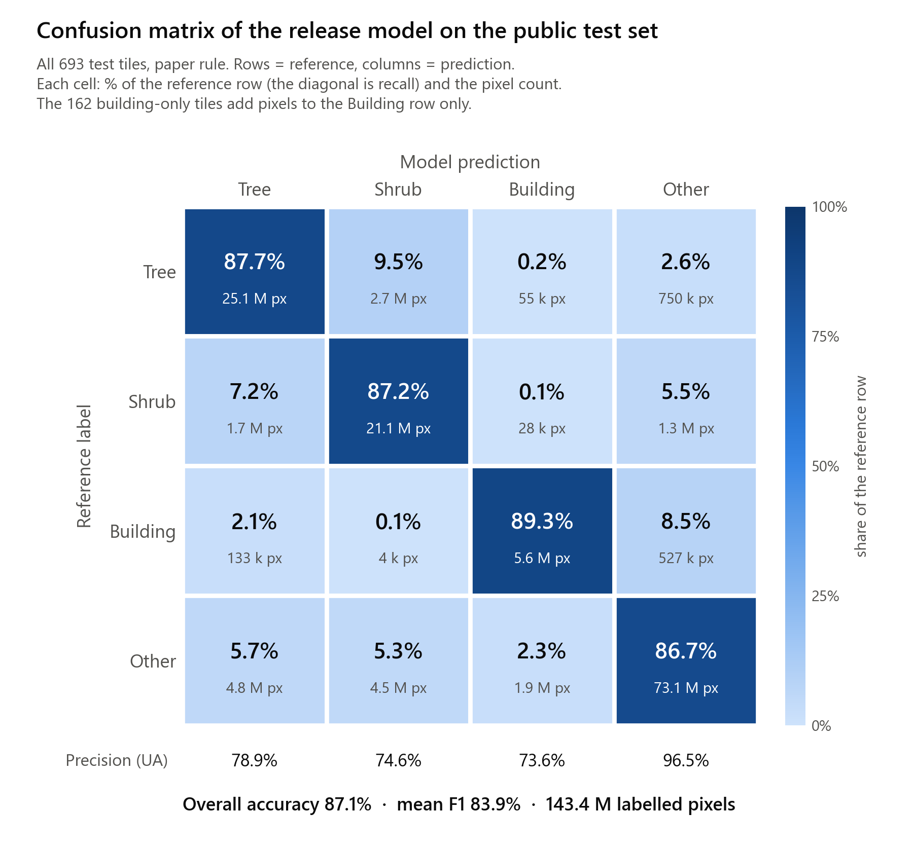
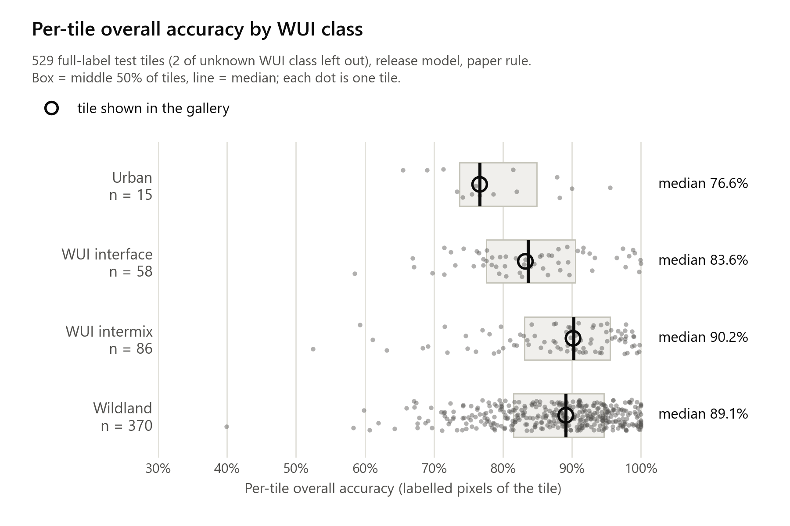
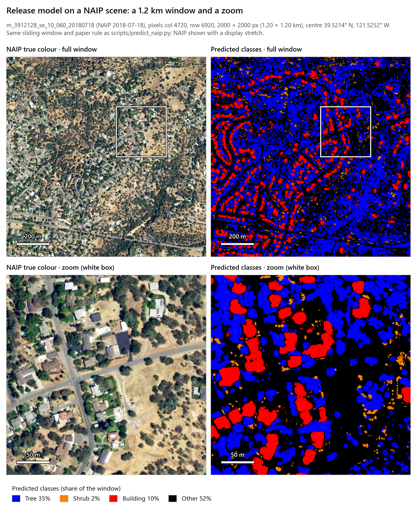

# Scalable Sub-meter Mapping of Woody Vegetation and Structures Across California

[](https://doi.org/10.1016/j.rse.2025.115091)
[](LICENSE)
[](LICENSE-DATA.md)
[](https://fuel-type-naip.projects.earthengine.app/view/fuel-mapping)

This repository accompanies the paper:

> **Zhu, Y., Dixon, D. J., & Jin, Y. (2026).** Scalable sub-meter mapping of woody vegetation and structures across California's heterogeneous landscape using deep learning. *Remote Sensing of Environment*, 333, 115091. https://doi.org/10.1016/j.rse.2025.115091

| Resource | Link |
|---|---|
| Paper (open access, CC BY 4.0) | https://doi.org/10.1016/j.rse.2025.115091 |
| Interactive map viewer (Google Earth Engine) | https://fuel-type-naip.projects.earthengine.app/view/fuel-mapping |
| Model weights and training/validation/test arrays | GitHub release [`v1.0.0`](https://github.com/YunzheZhu/fuel-mapping-CA/releases/tag/v1.0.0) |
| Statewide 0.6 m county maps (v2, 2016–2024) | Box: https://ucdavis.box.com/s/l3rssv9aiiigojzt0h7ql6gteqfdrogt |

**Contents:** [Method](#method-at-a-glance) · [Results from the paper](#results-from-the-paper) ·
[Try it yourself](#try-it-yourself-the-release-model-on-the-shared-test-data) · [Get started](#get-started) ·
[Data](#data-availability) · [Citation](#citation)

---

## Overview

A single deep learning model (U-Net) maps **trees, shrubs and building footprints at 0.6 m** across California from
open-access NAIP aerial imagery (R, G, B, NIR). It was trained on a large set of reference labels made
semi-automatically from aerial LiDAR. In the paper it reached 87.1 % overall accuracy on test tiles spread across
urban, wildland–urban interface (WUI) and wildland landscapes, and it was used to map the whole state every two years
from 2016 to 2022. Coarse land-cover products such as LANDFIRE (30 m) miss this canopy-scale detail. Maps at this
scale can support wildfire risk assessment, defensible-space evaluation, habitat-fragmentation analysis and planning
in the WUI.

**Key contributions**

- A **semi-automatic labeling workflow**: objects segmented from USGS 3DEP aerial LiDAR (42 surveys, 2015–2022), with
  initial classes from height and a planar mask, checked by a person against same-year NAIP. The result is a large
  set of wall-to-wall labels across urban, WUI and wildland landscapes.
- A **single unified U-Net** for tree, shrub, building and other pixels across the urban–WUI–wildland continuum.
- **Statewide biennial maps (2016, 2018, 2020, 2022)** at 0.6 m, viewable in the Earth Engine app.
- Detection of **fine-scale dynamics**: post-fire mortality, regrowth, selective logging and clear-cutting, and
  rebuilding after wildfire.

---

## Method at a glance

<p align="center">
  
</p>

**Fig. 1 · Study area and sampling.** (a) California's WUI types (FRAP 2015) and the four Regional Resource Kit (RRK)
planning regions. (b, c) The 307 m × 307 m LiDAR-labelled tiles used for training and testing, sampled across urban,
WUI and wildland strata and EPA Level III ecoregions. *Figure 1 from Zhu et al. (2026), CC BY 4.0.*

<p align="center">
  
</p>

**Fig. 2 · Semi-automatic labels from LiDAR.** LiDAR point clouds were segmented into objects. Each object got an
initial tree, shrub or building label from its height and a planar-surface mask, plus existing building footprints.
A person checked the labels against NAIP from the same year, and they were rasterized to 0.6 m and refined with an
NDVI mask. The exact rules and thresholds are in [`docs/PIPELINE.md`](docs/PIPELINE.md#2-labels).
*Figure 2 from Zhu et al. (2026), CC BY 4.0.*

<p align="center">
  
</p>

**Fig. 3 · The model.** A U-Net takes a 512 × 512 px NAIP tile with four bands and labels every pixel as tree, shrub,
building or other. The decoder channel counts in the drawing are schematic. The exact layers, and the decision rule
used for the paper's test-tile accuracy (probability thresholds plus an NDVI check), are in the
[model card](docs/MODEL_CARD.md#model-details). *Figure 3 from Zhu et al. (2026), CC BY 4.0.*

---

## Results from the paper

The figures and tables in this section are reproduced from the paper (open access, CC BY 4.0). Images were resized
for the web and are otherwise unchanged; full-resolution versions are in the article. **How the examples were
chosen:** Figs. 4, 5, 8 and 9 show examples that the authors picked to illustrate particular landscapes and events,
so they are not a random sample. The 600 change plots of Fig. 7 were identified by hand from repeat LiDAR and NAIP,
and Fig. S3 shows single plots from them. The region in Fig. 6 was chosen at random. The accuracy over all test
tiles is in Table 1 and Figs. S1–S2. All figures with longer captions are also in [`docs/figures/paper`](docs/figures/paper/README.md).
Click any figure to open it at full resolution.

### Accuracy on the test tiles

<p align="center">
  
</p>

**Fig. 4 · Five of the paper's 782 test tiles** (about 307 m × 307 m each). Columns: NAIP, model prediction, LiDAR
reference labels, LiDAR canopy height. Rows: (a) urban, Paso Robles; (b) WUI interface, north of Trinity Center;
(c) WUI intermix, north of the Alpine community (San Diego County); (d) wildland, northeast of Platina; (e) a
shrub-dominated wildland ridge south of Los Gatos. *Figure 4 from Zhu et al. (2026), CC BY 4.0.*

**Table 1 of the paper: matched NAIP–LiDAR year, overall and by WUI stratum** (782 test tiles)

| Scenario | OA | mIoU | F1 | F1 Tree | F1 Shrub | F1 Building | F1 Other |
|---|---|---|---|---|---|---|---|
| **Overall (single NAIP year)** | **87.1%** | 70.1% | 82.1% | 83.1% | 78.9% | 75.1% | 91.4% |
| Urban | 83.2% | 52.1% | 63.4% | 73.5% | 14.2% | 77.4% | 88.7% |
| WUI interface | 84.8% | 59.4% | 72.5% | 79.3% | 45.1% | 75.5% | 90.0% |
| WUI intermix | 87.2% | 61.4% | 74.2% | 85.6% | 51.4% | 68.1% | 91.5% |
| Wildland | 88.6% | 69.0% | 80.1%¹ | 83.8% | 83.8%¹ | 62.7% | 92.5% |

F1 is, to rounding, the unweighted mean of the four class F1 scores (other included). ¹ As printed in the paper. The
four class F1 values of this row average to 80.7 %, not 80.1 %, so one value in the row (possibly the repeated
83.8 %) is likely a typo in the paper. Shrubs in urban and WUI areas are the hardest case. The paper's tables also
give UA, PA and the four RRK regions; see the [model card](docs/MODEL_CARD.md#results-reported-in-the-paper).

<details>
<summary>Table 2 of the paper: stability across NAIP years (2016–2022)</summary>

Testing tiles with labels carried to every NAIP year:

| NAIP year | OA | mIoU | F1 | F1 Tree | F1 Shrub | F1 Building | F1 Other |
|---|---|---|---|---|---|---|---|
| Single NAIP year | 87.1% | 70.1% | 82.1% | 83.1% | 78.9% | 75.1% | 91.4% |
| 2016 | 85.0% | 66.7% | 79.6% | 81.6% | 72.5% | 74.5% | 89.8% |
| 2018 | 87.5% | 70.5% | 82.3% | 83.3% | 80.0% | 74.3% | 91.8% |
| 2020 | 85.0% | 67.2% | 80.0% | 82.8% | 73.5% | 74.1% | 89.7% |
| 2022 | 88.1% | 69.2% | 81.3% | 81.8% | 77.8% | 72.5% | 93.0% |

</details>

### Accuracy over a whole landscape

<p align="center">
  
</p>

**Fig. 6 · A randomly chosen 3,000 ha region in San Luis Obispo County**, separate from the training and test tiles,
with 2022 NAIP. Top: LiDAR canopy height, NAIP, LiDAR reference labels and the model prediction. Bottom: the pixel
confusion matrix (90 % overall agreement) and 30 m fractional cover compared with the LiDAR reference: tree
R² = 0.86, shrub R² = 0.93, building R² = 0.71. *Figure 6 from Zhu et al. (2026), CC BY 4.0.*

### Defensible space around single houses

<p align="center">
  
</p>

**Fig. 5 · Fuel around single buildings**, with California's defensible-space zones at 5 ft (red), 30 ft (orange)
and 100 ft (light yellow). Columns: false-colour NAIP, the 0.6 m model map, and 30 m LANDFIRE Existing Vegetation
Cover, which cannot resolve these zones. Sites: (a) north of Nimshew, Butte County; (b) northeast Santa Rosa near
Deadhorse Creek, Sonoma County; (c) south of Ojai, Ventura County (printed "Ojala" in the paper); (d) north of Santa
Barbara, in a Very High Fire Hazard Severity Zone. *Figure 5 from Zhu et al. (2026), CC BY 4.0.*

### Tracking change: logging, regrowth and fire

<p align="center">
  
</p>

**Fig. 7 · 600 plots of 30 m × 30 m near the 2018 Camp Fire**, 100 in each class: regrowth (RG), minimal change (MC),
selective logging (SL), clear cut (CC), severe burn (SB) and delayed post-fire mortality (DM; the printed caption
calls it "low severity burn"). Top: NAIP and LiDAR labels for 2018 and 2022, and model maps for 2016 to 2022.
Bottom: plot tree cover from the model, repeat LiDAR (2018, 2022) and LANDFIRE. In the paper, median tree cover of
the regrowth plots rose from 23 % in 2018 to 74 % in 2022, and tree cover of the severe-burn plots dropped from 72 %
to 5 % after the fire, consistent with LiDAR. *Figure 7 from Zhu et al. (2026), CC BY 4.0.*

<p align="center">
  
</p>

**Fig. 8 · The 2021 Dixie Fire**: model maps from pre-fire (2020) and post-fire (2022) NAIP, with 30 m tree cover
inside the perimeter. Close-ups: (c–f) a wildland area at the foot of Butt Mountain, where a few tree patches
survived; (g–j) Greenville, where the model maps buildings and the vegetation around them before the fire, and the
damage after it. The paper estimates that about 71 % of the tree area and 90 % of the shrub area inside the perimeter
burned. *Figure 8 from Zhu et al. (2026), CC BY 4.0.*

<p align="center">
  
</p>

**Fig. 9 · Building loss and rebuilding after the 2017 Tubbs Fire** in a Santa Rosa neighbourhood (perimeter in
yellow). Top: NAIP for 2016 to 2022; bottom: model predictions. The paper counts 1,725 buildings inside the
perimeter in 2016 and 338 in 2018 (a loss of more than 80 %); building coverage then rebounded to 76.8 % in 2020 and
91.7 % in 2022. *Figure 9 from Zhu et al. (2026), CC BY 4.0.*

### County and statewide maps

<p align="center">
  
</p>

**Fig. 10 · Sonoma County tree cover at 30 m**: the model on 2016 NAIP (a, b), county-wide aerial LiDAR (d) and
LANDFIRE 2016 EVC (e). Compared with 2013 LiDAR canopy cover, the model's tree cover explains about 70 % of the
variance (R² = 0.69, c); LANDFIRE reaches R² = 0.35 (f), underestimating dense and overestimating sparse tree cover.
Black areas are fire perimeters from 2008 to 2016. *Figure 10 from Zhu et al. (2026), CC BY 4.0.*

<p align="center">
  
</p>

**Fig. 11 · Statewide maps** of trees, shrubs and buildings at 0.6 m for 2016 (a) and 2022 (d); 30 m tree (b) and
shrub (e) cover for 2016; and the change in each from 2016 to 2022 (c, f). The bar charts give mean cover in each RRK
region every two years; the black line is the percent area burned in the two years before each NAIP year. These are
the paper's v1 maps; the v2 maps on Box come from a later model (see [Data availability](#data-availability)).
*Figure 11 from Zhu et al. (2026), CC BY 4.0.*

<details>
<summary>Supplementary figures S1–S3: accuracy by region and by year, single change plots</summary>

<p align="center">
  
</p>

**Fig. S1 · Error matrices by RRK region** (Sierra Nevada, Southern, Central and Northern California) for the
paper's test tiles at the LiDAR-matched NAIP year. Overall accuracy ranges from 84.7 % to 88.4 %.
*Figure S1 from Zhu et al. (2026), CC BY 4.0.*

<p align="center">
  
</p>

**Fig. S2 · The model on the 782 test tiles in each NAIP year.** For each year, a pixel error matrix (overall
accuracy 85 % to 88 %) and 30 m scatter plots of predicted vs. LiDAR-reference cover (R² 0.80 to 0.91 tree, 0.79 to
0.84 shrub, 0.72 to 0.88 building). *Figure S2 from Zhu et al. (2026), CC BY 4.0.*

<p align="center">
  
</p>

**Fig. S3 · One example plot per change class of Fig. 7**: regrowth, minimal change, selective logging and clear cut
at one site; severe burn and delayed mortality at another. NAIP, LiDAR labels and model maps for 2018 and 2022, plus
each plot's tree cover from the model, LiDAR and LANDFIRE. The second image in the top row is from 2022, although
its title reads "2012". *Figure S3 from Zhu et al. (2026), CC BY 4.0.*

</details>

---

## Try it yourself: the release model on the shared test data

This section shows what you get when you download the released model and the public test package and run the
script in this repository. Every figure here was made by one command of
[`scripts/make_demo_figures.py`](scripts/make_demo_figures.py) ([below](#make-these-figures-yourself)). The release-model
numbers come straight from that run and are also saved in
[`demo_metrics.json`](docs/figures/demo/demo_metrics.json); they match the evaluation in
[`docs/PIPELINE.md`](docs/PIPELINE.md#5-reproduce-the-release-model-accuracy).

The release model `fuelmap_unet_v1.pth` was retrained in June 2024 on the paper's training tiles, with the test
tiles held out. It is not the exact checkpoint behind the paper's tables. Its scores on the **693-tile public test
package** (`fuelmap_test_1y.npz`, each tile at its LiDAR-matched NAIP year, 143.4 million labelled pixels, paper
decision rule):

| Model and test set | Tiles | OA | mIoU | mean F1 | F1 Tree | F1 Shrub | F1 Building | F1 Other |
|---|---:|---|---|---|---|---|---|---|
| **Release model v1.0.0**, public test package | 693 | **87.1%** | 72.5% | 83.9% | 83.0% | 80.4% | 80.7% | 91.3% |
| Paper, Table 1 (for reference) | 782 | 87.1% | 70.1% | 82.1% | 83.1% | 78.9% | 75.1% | 91.4% |

The two rows are a rough check, not a like-for-like comparison:

- **Different tiles.** The public package holds 693 of the 806 tiles in the 2024 test array. The 113 urban-sample
  tiles from San Luis Obispo County are left out, because their building labels come from a footprint layer that may
  not be redistributed. The paper evaluated 782 tiles.
- **Building-only labels.** 162 of the 693 tiles are urban-sample tiles (Napa and Shasta counties) labelled for
  buildings only. They add building pixels but no tree, shrub or other pixels, so the overall building scores and
  mIoU are not directly comparable with Table 1. On the 531 full-label tiles alone, OA is 87.0 % and building F1 is
  60.1 %.
- **Checkpoint selection.** The training code kept epoch 47 because test-split Dice and mIoU had both improved, so
  these scores are not fully independent of checkpoint selection.

Per-class UA and PA, the argmax rule and results by WUI class and RRK region are in the
[model card](docs/MODEL_CARD.md#re-evaluation-of-the-release-model).

### Example tiles, chosen by a fixed rule

<p align="center">
  
</p>

One tile per WUI class from the public test package. **The tiles were not hand-picked:** each row is the tile whose
per-tile overall accuracy is closest to the median of its class (ties broken by tile_id), so they are typical tiles,
neither the best nor the worst. The bottom row applies the same rule to the 162 urban-sample tiles with building-only
labels; only their building pixels are scored (white = unlabelled). Columns: NAIP (display stretch), reference label,
prediction, and agreement (grey = correct, pink = error). The chosen tiles are listed in
[`demo_tiles.csv`](docs/figures/demo/demo_tiles.csv). Rows group tiles by their WUI class (`wui_class`, the class
used for the paper's accuracy strata); the tile_id prefix (`URB`, `WUI`, `WLD`) is the sampling stratum, which can
differ. For example, the Urban row is a residential area among dense trees that was sampled in the WUI stratum.

What you can see: most errors lie along object edges and at tree–shrub boundaries. Predicted buildings are rounder
and somewhat larger than the reference footprints (urban row), and a few false building patches appear in the WUI
interface tile.

### Confusion matrix

<p align="center">
  
</p>

Confusion matrix over all 693 public test tiles (rows = reference, columns = prediction; each cell gives the % of the
reference row and the pixel count). The diagonal is recall. The main confusions are tree vs. shrub (9.5 % of tree
pixels predicted as shrub, 7.2 % of shrub pixels as tree) and vegetation vs. other. The 162 building-only urban
tiles add pixels to the Building row only, so building precision looks better than it would with full labels.
Note: the paper's matrices (Figs. 6, S1 and S2) are the other way round: rows = prediction, columns = reference, and
"Background" = Other.

### Accuracy varies from tile to tile

<p align="center">
  
</p>

Per-tile overall accuracy of the 529 full-label test tiles with a known WUI class (2 tiles of unknown class left out).
Medians: urban 76.6 % (n = 15), WUI interface 83.6 % (58), WUI intermix 90.2 % (86), wildland 89.1 % (370). 406 of
the 529 tiles (77 %) score 80 % or more, but 6 fall below 60 % (the lowest, 40 %); these counts are under
`per_tile_oa_full_label` in [`demo_metrics.json`](docs/figures/demo/demo_metrics.json). Rings mark the gallery
tiles, which sit at the medians by construction.

### A NAIP scene outside the labelled tiles

<p align="center">
  
</p>

The release model on a 2,000 × 2,000 px (1.2 km) window of NAIP quarter-quad `m_3912128_se_10_060_20180718` (near
Oroville, Butte County, 18 July 2018), with the same sliding window and decision rule as `scripts/predict_naip.py`.
**The scene (a 2018 quarter-quad with no labelled tile in it), the window and the zoom box were chosen by eye** to
show houses among oak woodland; the prediction is shown unedited (tree 35 %, shrub 2 %, building 10 %, other 52 %
of the window). There are no reference labels here, so this shows what the output looks like, not how accurate it
is. Predicted buildings are rounder and somewhat larger than the roofs, and most of the oak woodland is mapped as
tree.

### Make these figures yourself

```bash
# from the root of a clone of this repo, with the environment from "Get started" below
BASE=https://github.com/YunzheZhu/fuel-mapping-CA/releases/download/v1.0.0
curl -L -o models/fuelmap_unet_v1.pth $BASE/fuelmap_unet_v1.pth                        # 124 MB
mkdir -p release && curl -L -o release/fuelmap_test_1y.npz $BASE/fuelmap_test_1y.npz   # 615 MB

python scripts/make_demo_figures.py --weights models/fuelmap_unet_v1.pth \
    --test-npz release/fuelmap_test_1y.npz --index data/test_array_index.csv \
    --pred-cache outputs/demo_pred_cache.npz \
    --naip m_3912128_se_10_060_20180718.tif --naip-window 4720 6920 2000 2000 --zoom 1100 500 500
```

This takes about 8 minutes on a 24-core CPU and writes the figures, `demo_metrics.json` (all numbers above) and
`demo_tiles.csv` to `docs/figures/demo/` (change with `--out-dir`); a second run that reuses `--pred-cache` takes
seconds. It needs matplotlib ≥ 3.6 in addition to the [requirements](#get-started) (listed under "Optional" in
[`requirements.txt`](requirements.txt)). The NAIP scene is not part of the release: download it from USGS
EarthExplorer (NAIP) or the Microsoft Planetary Computer `naip` collection (copies from other sources may differ
slightly), or leave out the last line's `--naip …` options to make only the test-tile figures. More options:
[`docs/PIPELINE.md`](docs/PIPELINE.md#readme-demo-figures).

---

## Get started

```bash
git clone https://github.com/YunzheZhu/fuel-mapping-CA.git && cd fuel-mapping-CA
conda env create -f environment.yml && conda activate fuelmap        # or: pip install -r requirements.txt
curl -L -o models/fuelmap_unet_v1.pth \
    https://github.com/YunzheZhu/fuel-mapping-CA/releases/download/v1.0.0/fuelmap_unet_v1.pth
python scripts/predict_naip.py --weights models/fuelmap_unet_v1.pth \
    --input m_3912127_ne_10_060_20180718.tif --output m_3912127_ne_10_060_20180718_class.tif
```

The input is any NAIP GeoTIFF, COG or VRT with bands R, G, B, NIR. The output is a 0.6 m class GeoTIFF on the input
grid (0 other, 1 tree, 2 shrub, 3 building, 255 nodata); a full quarter-quad takes about 15 minutes on a 12-thread CPU.

- [`docs/PIPELINE.md`](docs/PIPELINE.md): full usage. Installation and tested versions, a check on the sample tiles,
  LiDAR labeling, training, test-tile evaluation, large-scene mapping, mosaics, 30 m cover, the Python API and the
  repository layout.
- [`docs/MODEL_CARD.md`](docs/MODEL_CARD.md) and [`models/README.md`](models/README.md): architecture, decision rule,
  training settings, all accuracy tables, limitations and differences from the paper text.
- [`docs/DATA.md`](docs/DATA.md) and [`data/README.md`](data/README.md): release files and checksums, array format,
  tile index, statewide maps.

---

## Data availability

| Product | Where |
|---|---|
| Release model weights (124.2 MB) and metadata | GitHub release [`v1.0.0`](https://github.com/YunzheZhu/fuel-mapping-CA/releases/tag/v1.0.0) |
| Test (693 tiles), validation (1,512 tile-years) and training (10,218 tile-years) arrays as `.npz` | GitHub release [`v1.0.0`](https://github.com/YunzheZhu/fuel-mapping-CA/releases/tag/v1.0.0) (11.20 GB with the weights) |
| Tile index (8,256 labelled tiles), test-array index, 4 sample NAIP + label tiles | [`data/`](data/README.md) in this repository |
| Statewide 0.6 m county class maps, 2016–2024 (392.6 GB) | [Box](https://ucdavis.box.com/s/l3rssv9aiiigojzt0h7ql6gteqfdrogt) |
| Interactive viewer | [Google Earth Engine app](https://fuel-type-naip.projects.earthengine.app/view/fuel-mapping) |

- **The Box maps are the improved v2 (2026) maps.** A later fine-tuned model produced them, and they are **not** the
  v1 maps used in the paper. The original v1 maps (2016–2022) are available from the authors on request.
- The urban-sample tiles from San Luis Obispo County (113 test and 751 training tiles) are not in the public arrays,
  because that county's footprint layer may not be redistributed.

File sizes, checksums, array members and the Box folder layout are in [`docs/DATA.md`](docs/DATA.md).

---

## Class legend

| Value | Class | Colour in the paper's maps and in class GeoTIFFs written by this code |
|---|---|---|
| 0 | Other (background: bare ground, grass, crops, water, roads, …) | black `#000000` |
| 1 | Tree (woody, 95th-percentile height ≥ 5 m) | blue `#0000FF` |
| 2 | Shrub (woody, 1–5 m) | orange `#FF7F00` |
| 3 | Building | red `#FF0000` |
| 4 | Uncertain (**v2 Box maps only**) | – |
| 255 | Nodata (outside the NAIP footprint); "no label" in label files | – |

---

## Citation

If you use this code, the model or the data, please cite the paper:

```bibtex
@article{Zhu2026RSE,
  author    = {Zhu, Yunzhe and Dixon, Dan J. and Jin, Yufang},
  title     = {Scalable sub-meter mapping of woody vegetation and structures across {California}'s heterogeneous landscape using deep learning},
  journal   = {Remote Sensing of Environment},
  volume    = {333},
  pages     = {115091},
  year      = {2026},
  issn      = {0034-4257},
  doi       = {10.1016/j.rse.2025.115091},
  url       = {https://doi.org/10.1016/j.rse.2025.115091},
  publisher = {Elsevier}
}
```

APA: Zhu, Y., Dixon, D. J., & Jin, Y. (2026). Scalable sub-meter mapping of woody vegetation and structures across
California's heterogeneous landscape using deep learning. *Remote Sensing of Environment, 333*, Article 115091.
https://doi.org/10.1016/j.rse.2025.115091

GitHub's "Cite this repository" button reads [`CITATION.cff`](CITATION.cff).

---

## License

- **Code:** GNU General Public License v3.0 ([`LICENSE`](LICENSE)). The U-Net implementation (`fuelmap/model.py`) and
  parts of the training loop (`scripts/train.py`) are adapted from
  [milesial/Pytorch-UNet](https://github.com/milesial/Pytorch-UNet) (GPL-3.0).
- **Data, labels, model weights and map products:** Creative Commons Attribution 4.0 International (CC BY 4.0), see
  [`LICENSE-DATA.md`](LICENSE-DATA.md), which also covers the third-party sources (NAIP, USGS 3DEP and the county
  building footprints behind some building labels).
- **Paper figures** in [`docs/figures/paper`](docs/figures/paper/README.md) are from Zhu et al. (2026), reused under
  CC BY 4.0.

---

## Acknowledgments

This research was funded by the NASA Land Cover and Land Use Change Program (grant 80NSSC21K0295). It was also partially
supported by the USDA National Institute of Food and Agriculture (Hatch project CA-DLAW2620-H) and by AmericaView
through the National Land Remote Sensing Education, Outreach and Research Activity (NLRSEORA) grant from the U.S.
Geological Survey (USGS) National Land Imaging (NLI) program.

---

## Contact

**Yunzhe Zhu**, ypfzhu@ucdavis.edu<br>
Department of Land, Air, and Water Resources, University of California, Davis

For bug reports or questions about the code, please open an [issue](https://github.com/YunzheZhu/fuel-mapping-CA/issues).

---

## Roadmap

- [x] **v1.0.0**: code for labeling, training, prediction and evaluation; release model; training, validation and test
  arrays; tile index.
- [x] **v2 statewide maps (2016–2024)** on Box.
- [ ] **v2 model** (forthcoming): the fine-tuned model behind the v2 maps, with its accuracy assessment. The results will
  be added here and kept separate from the paper's v1 results.
