# Figures from the paper

These are web-sized copies of the figures in:

> Zhu, Y., Dixon, D. J., & Jin, Y. (2026). Scalable sub-meter mapping of woody vegetation and structures across California's heterogeneous landscape using deep learning. *Remote Sensing of Environment*, 333, 115091. https://doi.org/10.1016/j.rse.2025.115091

The article is open access under [CC BY 4.0](https://creativecommons.org/licenses/by/4.0/). Each figure below is reused under that license with the credit line shown.

**Changes from the originals.** The copies were made from the final figure files submitted with the article. Each was resized to 2000–2400 px wide and re-encoded as JPEG (photo-like figures) or palette PNG (diagrams). Transparent backgrounds were flattened to white. Nothing in any figure was edited or cropped. Full-resolution versions are in the article and its online supplement.

Fig. 4, 5, 8 and 9 show examples that the authors chose to illustrate particular landscapes and events, so they are not a random sample. The accuracy over all of the paper's test tiles is in Table 1 and in Fig. S1 and S2. The Fig. 6 region was chosen at random.

| File | Paper figure | Content |
|---|---|---|
| [fig01_study_area.jpg](fig01_study_area.jpg) | Fig. 1 | Study area and where the training and test tiles are |
| [fig02_labeling_workflow.jpg](fig02_labeling_workflow.jpg) | Fig. 2 | How the LiDAR-based reference labels were made |
| [fig03_unet.png](fig03_unet.png) | Fig. 3 | U-Net model diagram |
| [fig04_test_examples.jpg](fig04_test_examples.jpg) | Fig. 4 | Predictions on five test tiles, urban to wildland |
| [fig05_defensible_space.jpg](fig05_defensible_space.jpg) | Fig. 5 | Single houses with defensible-space zones, compared with LANDFIRE |
| [fig06_slo_large_area.jpg](fig06_slo_large_area.jpg) | Fig. 6 | Accuracy over a 3,000 ha region in San Luis Obispo County |
| [fig07_camp_fire_plots.jpg](fig07_camp_fire_plots.jpg) | Fig. 7 | Change from 2016 to 2022 in 600 plots near the 2018 Camp Fire |
| [fig08_dixie_fire.jpg](fig08_dixie_fire.jpg) | Fig. 8 | 2021 Dixie Fire, before and after |
| [fig09_tubbs_rebuilding.jpg](fig09_tubbs_rebuilding.jpg) | Fig. 9 | Building loss and rebuilding after the 2017 Tubbs Fire |
| [fig10_sonoma_vs_landfire.jpg](fig10_sonoma_vs_landfire.jpg) | Fig. 10 | Sonoma County tree cover: this model vs LiDAR vs LANDFIRE |
| [fig11_statewide_maps.jpg](fig11_statewide_maps.jpg) | Fig. 11 | Statewide maps for 2016 and 2022, with regional trends |
| [figS1_rrk_error_matrices.png](figS1_rrk_error_matrices.png) | Fig. S1 | Error matrices by region |
| [figS2_yearly_accuracy.jpg](figS2_yearly_accuracy.jpg) | Fig. S2 | Accuracy for each NAIP year, 2016–2022 |
| [figS3_plot_examples.jpg](figS3_plot_examples.jpg) | Fig. S3 | Close-up of individual change plots |

In the class maps, **blue** is tree, **orange** is shrub, **red** is building and **black** is other (labelled "background" in some panels). The LANDFIRE panels and the 30 m cover maps use their own colour scales.

---

### Fig. 1: Study area

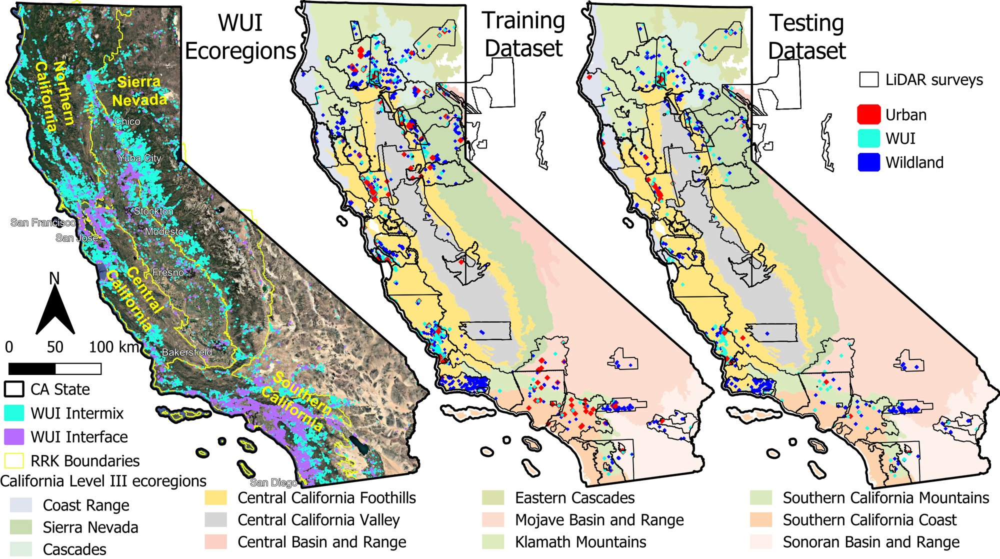

(a) California's wildland-urban interface (WUI) types from FRAP 2015 and the four Regional Resource Kit (RRK) planning regions. (b, c) The 307 m × 307 m LiDAR-labelled tiles used for training and testing, coloured by urban, WUI or wildland stratum, over EPA Level III ecoregions.

*Figure 1 from Zhu et al. (2026), CC BY 4.0.*

### Fig. 2: Label workflow

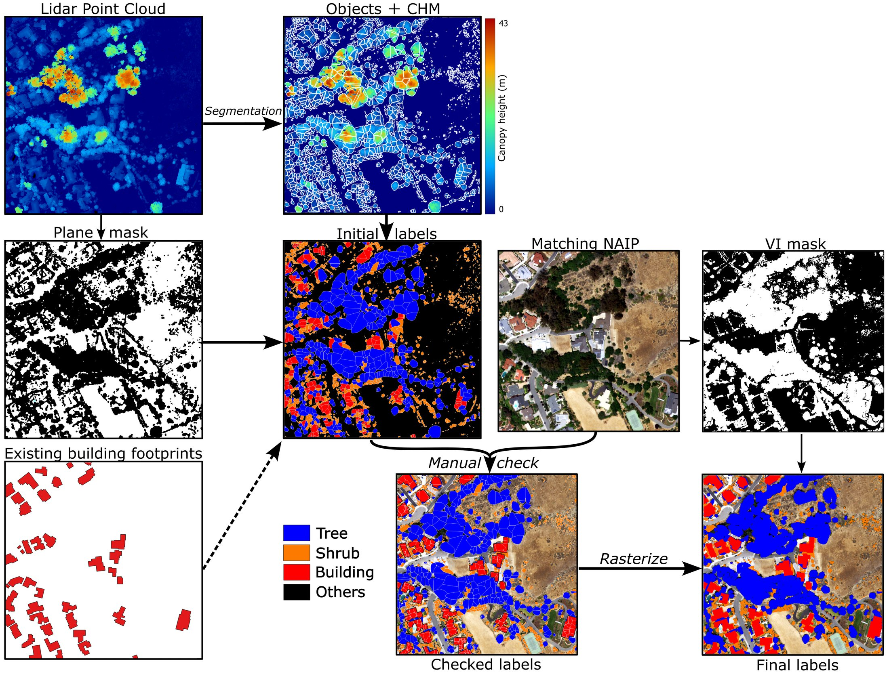

The reference labels were made semi-automatically, in four steps:

1. Aerial LiDAR point clouds were segmented into objects.
2. Each object got an initial tree, shrub or building label from its height and a planar-surface mask, with existing building footprints as an extra input.
3. The labels were checked and corrected by hand against NAIP from the same year as the LiDAR.
4. The labels were rasterized to 0.6 m and refined with an NDVI (vegetation index) mask.

*Figure 2 from Zhu et al. (2026), CC BY 4.0.*

### Fig. 3: U-Net model

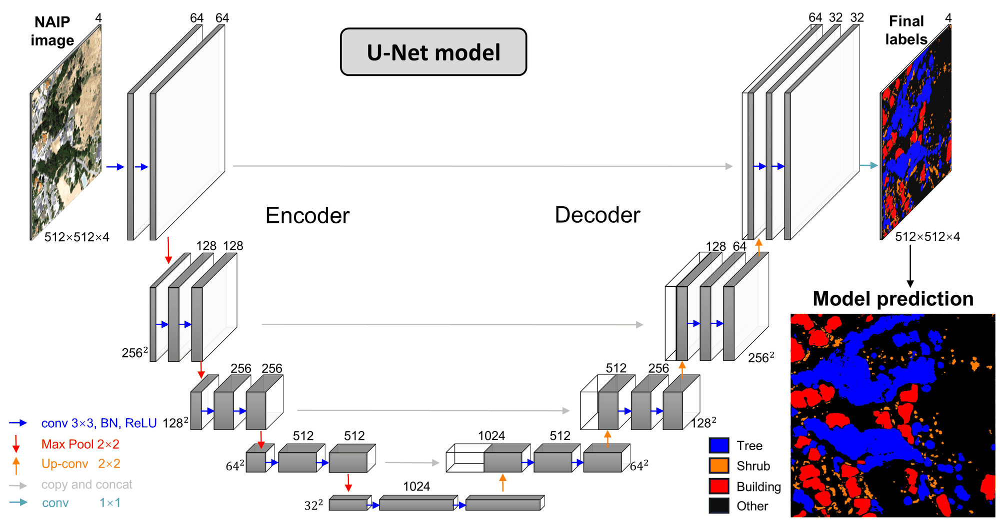

The model takes a 512 × 512 pixel NAIP tile with four bands (red, green, blue, near-infrared) and labels every pixel as tree, shrub, building or other. It is an encoder–decoder with skip connections. The numbers give the channels and the image size at each level. The decoder channel counts in the drawing are schematic: see [MODEL_CARD.md](../../MODEL_CARD.md) for the exact layers of the released model.

*Figure 3 from Zhu et al. (2026), CC BY 4.0.*

### Fig. 4: Example test tiles

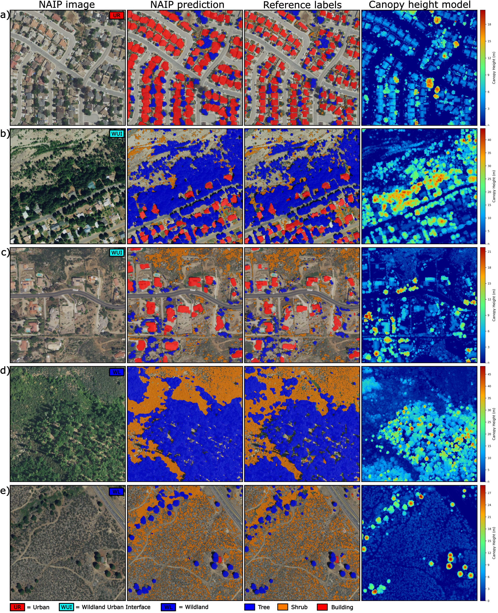

Model output on five of the paper's 782 test tiles, each about 307 m × 307 m. From left to right: NAIP image, model prediction, LiDAR-derived reference labels and LiDAR canopy height. The rows are:
- (a) urban, Paso Robles
- (b) WUI interface, north of Trinity Center
- (c) WUI intermix, Alpine (San Diego County)
- (d) wildland, northeast of Platina
- (e) wildland, south of Los Gatos

*Figure 4 from Zhu et al. (2026), CC BY 4.0.*

### Fig. 5: Defensible space around single houses

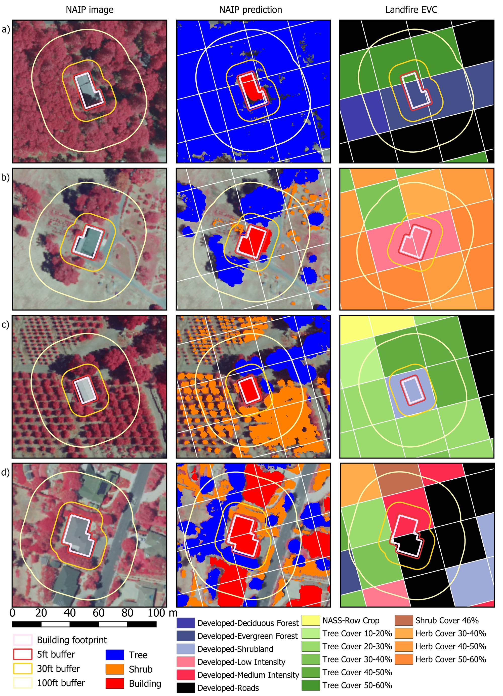

Fuel around single buildings, shown with California's defensible-space zones as buffers: 5 ft (red), 30 ft (orange) and 100 ft (light yellow). The columns are false-colour NAIP, the 0.6 m model map and the 30 m LANDFIRE Existing Vegetation Cover, which cannot resolve these zones. The sites are:
- (a) north of Nimshew, Butte County
- (b) northeast Santa Rosa, near Deadhorse Creek
- (c) south of Ojai, Ventura County (spelled "Ojala" in the printed caption)
- (d) north of Santa Barbara, in a Very High Fire Hazard Severity Zone

*Figure 5 from Zhu et al. (2026), CC BY 4.0.*

### Fig. 6: Large-area check in San Luis Obispo County

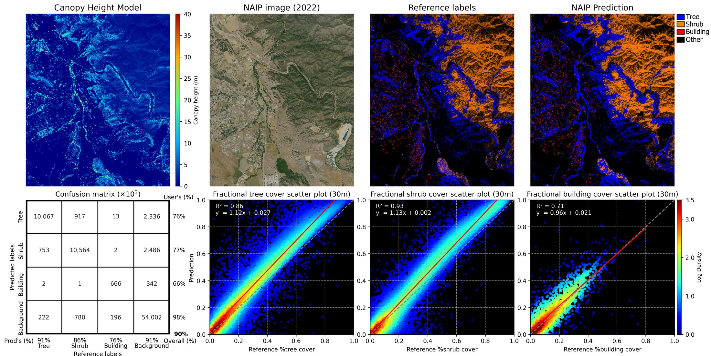

The paper also tested the model on a randomly chosen 3,000 ha region in San Luis Obispo County, separate from the training and test tiles, using 2022 NAIP.
- **Top row:** LiDAR canopy height, NAIP, LiDAR reference labels and model prediction.
- **Bottom row:** the pixel confusion matrix (90% overall agreement), and scatter plots of predicted vs. reference cover at 30 m. The R² is 0.86 for tree, 0.93 for shrub and 0.71 for building.

*Figure 6 from Zhu et al. (2026), CC BY 4.0.*

### Fig. 7: Change over time near the Camp Fire

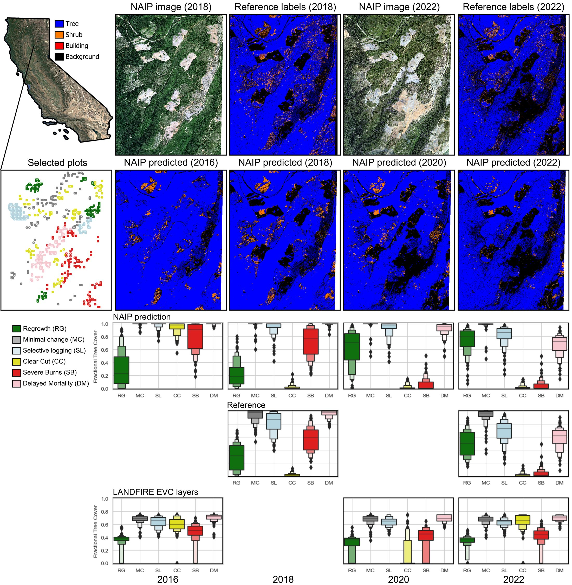

The paper tracked 600 plots of 30 m × 30 m in the northern Sierra Nevada near the 2018 Camp Fire. There are 100 plots in each of six classes: regrowth (RG), minimal change (MC), selective logging (SL), clear cut (CC), severe burn (SB) and delayed post-fire tree mortality (DM).
- **Top:** NAIP and LiDAR labels for 2018 and 2022, and model maps for 2016, 2018, 2020 and 2022.
- **Bottom:** tree cover in the plots from the model, from repeat LiDAR (2018 and 2022) and from LANDFIRE.

The printed caption calls DM "low severity burn". The legend and the paper's text call it delayed mortality.

*Figure 7 from Zhu et al. (2026), CC BY 4.0.*

### Fig. 8: The 2021 Dixie Fire

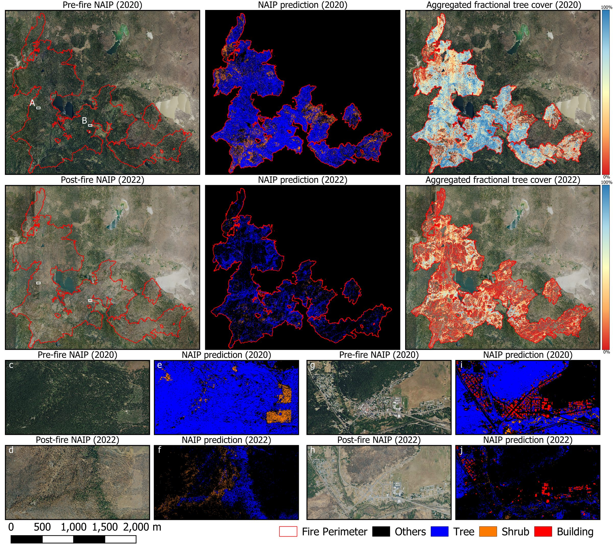

Model maps from pre-fire (2020) and post-fire (2022) NAIP, with 30 m tree cover inside the fire perimeter. There are two close-ups:
- (c–f) a wildland area at the foot of Butt Mountain, where a few patches of trees survived.
- (g–j) the town of Greenville, where the model maps buildings and the trees and shrubs around them before the fire, and the damage after it.

The paper estimates that about 71% of the tree area and 90% of the shrub area inside the perimeter burned.

*Figure 8 from Zhu et al. (2026), CC BY 4.0.*

### Fig. 9: Rebuilding after the Tubbs Fire

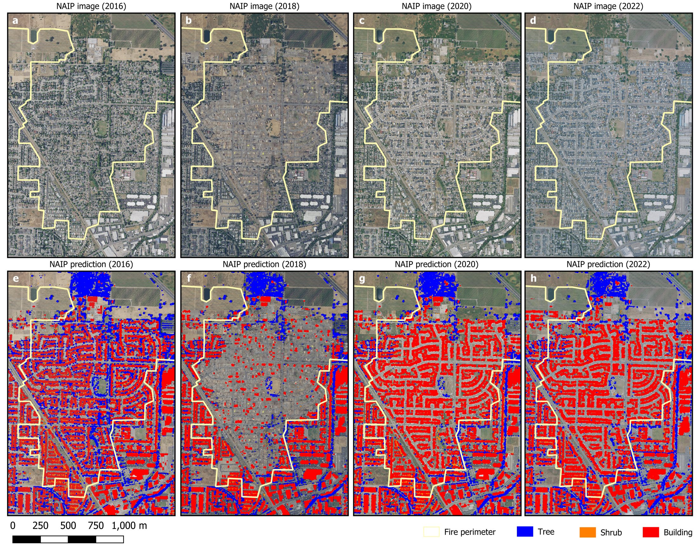

A Santa Rosa neighbourhood burned by the 2017 Tubbs Fire (fire perimeter in yellow). The top row is NAIP for 2016, 2018, 2020 and 2022, and the bottom row is the model predictions. The paper counts 1,725 buildings inside the perimeter in 2016 and 338 in 2018, a loss of more than 80%. Building coverage then rebounded to 76.8% in 2020 and 91.7% in 2022.

*Figure 9 from Zhu et al. (2026), CC BY 4.0.*

### Fig. 10: Sonoma County, model vs LiDAR vs LANDFIRE

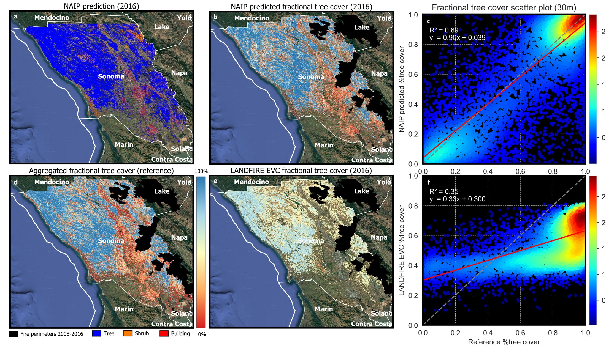

Tree cover at 30 m across Sonoma County from three sources: the model applied to 2016 NAIP (a, b), county-wide aerial LiDAR (d) and LANDFIRE 2016 Existing Vegetation Cover (e). Measured against LiDAR, the model explains about 70% of the variance (R² = 0.69, panel c). LANDFIRE explains 0.35 (panel f): it underestimates dense tree cover and overestimates sparse tree cover. Black areas are fire perimeters from 2008 to 2016.

*Figure 10 from Zhu et al. (2026), CC BY 4.0.*

### Fig. 11: Statewide maps

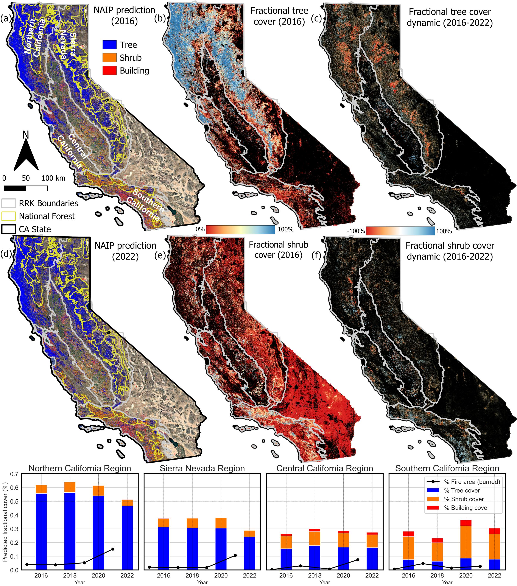

Statewide maps at 0.6 m of trees, shrubs and buildings for 2016 (a) and 2022 (d), and 30 m tree cover (b) and shrub cover (e) for 2016. Panels (c) and (f) show the change in tree and shrub cover from 2016 to 2022. The bar charts give the mean cover in each RRK region every two years. The black line is the percent area burned in the two years before each NAIP year.

*Figure 11 from Zhu et al. (2026), CC BY 4.0.*

### Fig. S1: Error matrices by region

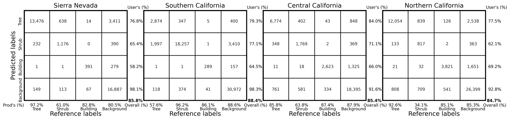

Pixel-level error matrices for the paper's test tiles, using NAIP from the same year as the LiDAR, split into the four RRK regions: Sierra Nevada, Southern California, Central California and Northern California. Each matrix shows user's and producer's accuracy per class. Overall accuracy ranges from 84.7% to 88.4%.

*Figure S1 from Zhu et al. (2026), CC BY 4.0.*

### Fig. S2: Accuracy in each NAIP year

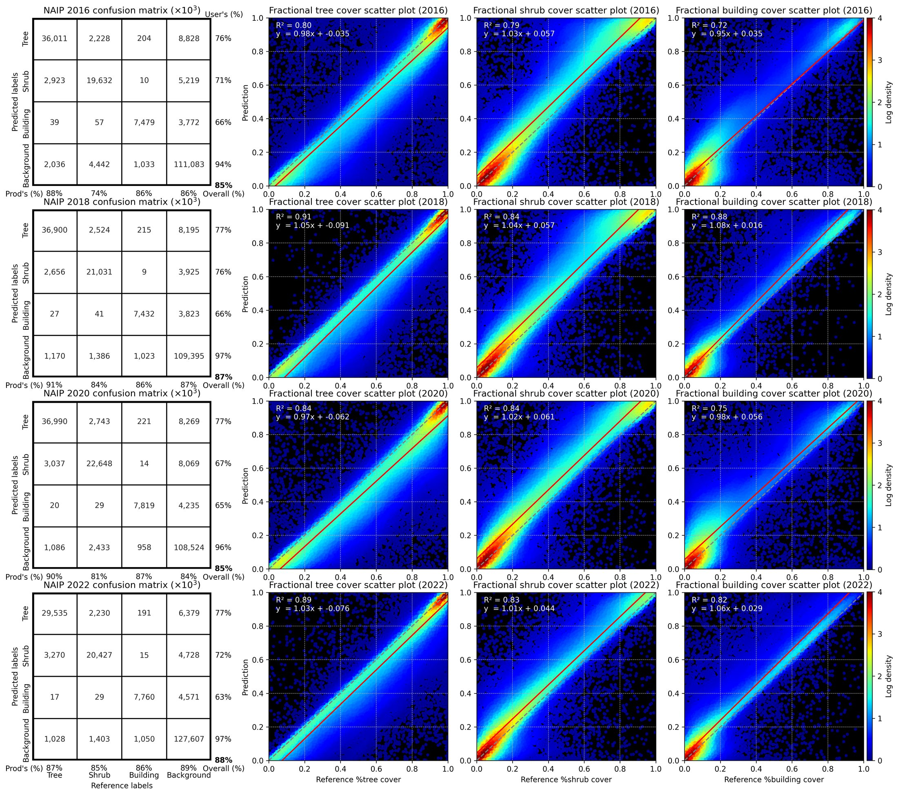

The model applied to the 782 test tiles in each of the four NAIP years (2016, 2018, 2020 and 2022). For each year there is a pixel error matrix, with overall accuracy of 85% to 88%. There are also scatter plots of predicted vs. LiDAR-reference cover at 30 m. The R² ranges are 0.80 to 0.91 for tree, 0.79 to 0.84 for shrub and 0.72 to 0.88 for building.

*Figure S2 from Zhu et al. (2026), CC BY 4.0.*

### Fig. S3: Close-up of change plots

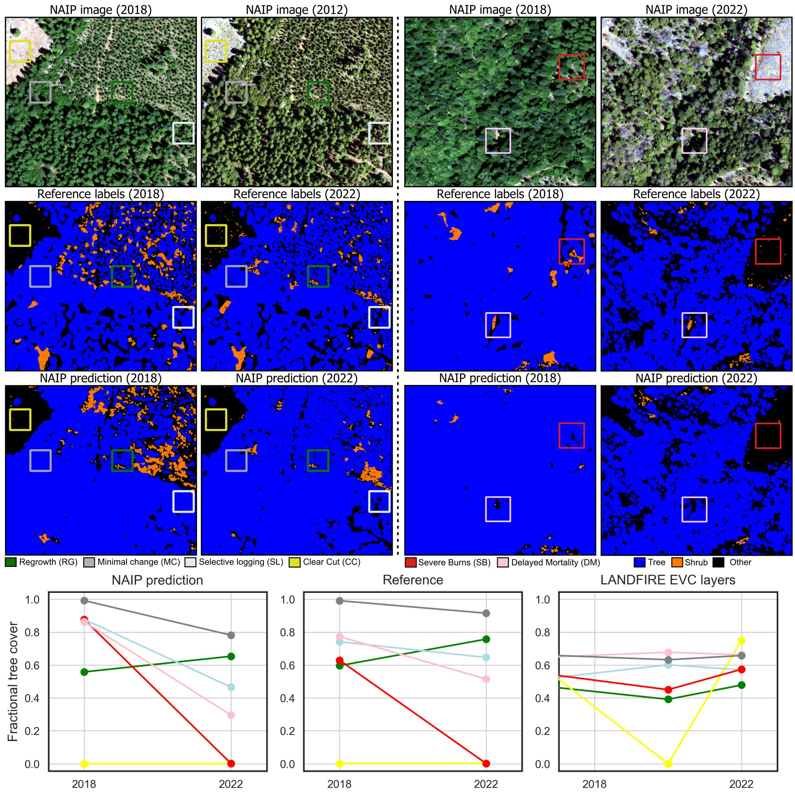

Single example plots for each change class in Fig. 7:
- **Left site:** regrowth, minimal change, selective logging and clear cut.
- **Right site:** severe burn and delayed mortality.

NAIP, LiDAR labels and model maps are shown for 2018 and 2022. The line charts give each plot's tree cover from the model, from LiDAR and from LANDFIRE (2016, 2020 and 2022). The second image in the top row is from 2022, although its title reads "2012".

*Figure S3 from Zhu et al. (2026), CC BY 4.0.*
